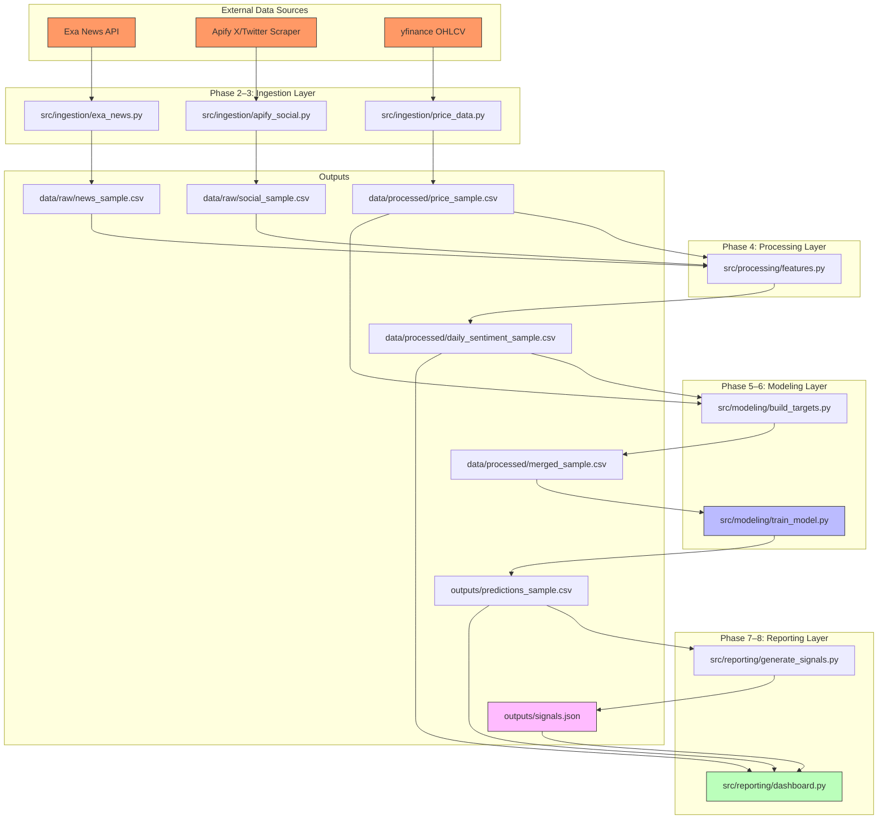

# HengSeng Sentiment Price-Prediction Agent

A quantitative sentiment-driven price-prediction agent for HengSeng-index-adjacent
equities (starting with Tencent `0700.HK` and Samsung `005930.KS`). The pipeline
ingests real financial news (Exa) and social media mentions (Apify X scraper),
scores sentiment locally with `vaderSentiment`, engineers features, predicts
next-day returns with a LightGBM walk-forward model, and exposes signals via a
Bloomberg Terminal-style Streamlit dashboard and a structured JSON signal feed.

 All code is modular, documented, and PEP 8.

---

## 🔴 Zero Look-Ahead Bias (Architecture Guarantee)

Look-ahead bias is the silent killer of quantitative models. This agent is
architected so that **tomorrow's data is never used to predict tomorrow's
price**. The guarantee is enforced at three layers:

### 1. Ingestion (no future content)
`src/ingestion/exa_news.py` and `src/ingestion/apify_social.py` only return
articles/posts published or created **on or before** the requested cutoff date.
Future-dated content is never fetched or included.

### 2. Target creation (shifted correctly)
`src/modeling/build_targets.py` builds the target as:

```
target_next_return = (Close tomorrow − Close today) / Close today
```

using `close.shift(-1)` **per ticker**. The row for Date N contains:
* **Features** from Date N (price, sentiment, technicals)
* **Target label** derived from Close(N+1)

The target is stored as the supervised *label* for today's row only — it is
**never** fed back as a feature for any row. The last row per ticker is dropped
because tomorrow's close is unknown.

### 3. Modeling (expanding window, no shuffling)
`src/modeling/train_model.py` uses walk-forward validation with an expanding
window: for each test date T, the model trains **only** on dates strictly
before T. No `train_test_split`, no random shuffling — time order is strictly
preserved.

---

## 📋 Methodology

### Engagement-Weighted Sentiment

Raw sentiment (vaderSentiment compound score, −1 to +1) is noisy on its own.
The agent weights social signals by engagement so that a post from a large,
highly-engaged account moves the needle more than a low-follower, low-engagement
post:

```
engagement_weight = log(1 + likes + retweets) × log(1 + author_followers)
```

Daily social sentiment per ticker is the **engagement-weighted average** of
post-level compound scores. News sentiment is a simple average of article
compound scores. The two are combined into a single `daily_sentiment_score`
weighted by the relative volume of social vs. news content.

### Feature Set

| Feature | Description |
|---------|-------------|
| `open`, `high`, `low`, `close`, `volume` | Daily OHLCV (yfinance) |
| `daily_sentiment_score` | Combined social + news sentiment |
| `social_post_count`, `news_article_count` | Daily content volume |
| `avg_engagement_weight` | Mean engagement weight of social posts |
| `rsi_14` | 14-day Relative Strength Index (Wilder's smoothing) |
| `vol_10d` | 10-day rolling volatility (std of daily returns) |
| `ret_5d` | 5-day close-to-close return |

### Target

`target_next_return = (Close tomorrow − Close today) / Close today`

### Model

LightGBM Regressor (`objective=regression`, `metric=rmse`) with walk-forward
validation. Metrics reported: **directional accuracy** (did it predict up/down
correctly?) and **RMSE**.

---

## ⚠️ Limitations & Intellectual Honesty

While engagement-weighted social sentiment shows a measurable correlation with
asset volatility, predicting directional alpha on a strict next-day basis
requires tighter integration with technical support/resistance levels,
microstructure data, and order-flow signals beyond what this research
prototype currently incorporates. The model deliberately prioritizes
transparent, non-overfitted signals and realistic walk-forward baselines over
artificially inflated accuracy metrics. Directional accuracy and RMSE are
reported honestly on expanding-window validation folds, with no hyperparameter
search leakage or look-ahead contamination.

---

## 🚀 Quickstart

### 1. Clone & install

```bash
git clone https://github.com/Anjalii146/Sentiment-Price-Prediction-Agent.git
cd Sentiment-Price-Prediction-Agent
python -m venv .venv
.venv\Scripts\activate        # Windows
# source .venv/bin/activate   # macOS/Linux
pip install -r requirements.txt
```

### 2. Configure API keys

Copy the example env file and fill in your credentials:

```bash
copy .env.example .env        # Windows
# cp .env.example .env        # macOS/Linux
```

Edit `.env` with your `APIFY_API_TOKEN`, `APIFY_X_SCRAPER_ACTOR_ID`, and
`EXA_API_KEY`. The pipeline runs on clearly-labeled **sample data** when
credentials are absent, so you can develop end-to-end without live keys.

### 3. Run Phase 1–3 ingestion (sample data)

```bash
python src\ingestion\exa_news.py
python src\ingestion\apify_social.py
```

Produces `data/raw/news_sample.csv` (5 articles per ticker) and
`data/raw/social_sample.csv` (10 posts per ticker).

### 4. Run Phase 4 price + sentiment processing

```bash
python src\ingestion\price_data.py
python src\processing\features.py
```

Produces `data/processed/price_sample.csv` and
`data/processed/daily_sentiment_sample.csv`.

### 5. Run Phase 5 merge + target creation

```bash
python src\modeling\build_targets.py
```

Produces `data/processed/merged_sample.csv` — model-ready data with features
from Date N and `target_next_return` from N+1.

### 6. Run Phase 6 walk-forward model

```bash
python src\modeling\train_model.py
```

Produces `outputs/predictions_sample.csv` with directional accuracy and RMSE.

### 7. Generate JSON signals (Phase 8)

```bash
python src\reporting\generate_signals.py
```

Produces `outputs/signals.json` — structured signals for downstream systems.

### 8. Launch the dashboard (Phase 7)

```bash
streamlit run src\reporting\dashboard.py
```

Bloomberg Terminal-style UI: metric cards, candlestick + sentiment chart, and
a news sentiment table.

---

## 🏗️ System Architecture



> `data/raw/`, `data/processed/`, and `outputs/` contain generated artifacts and
> are gitignored. Regenerate them by running the pipeline scripts above.

---

## 🧩 Pipeline Phases

| Phase | Component | File |
|-------|-----------|------|
| 1 | Repository setup & config | `requirements.txt`, `.env.example`, `config/assets.yaml` |
| 2–3 | Ingestion (Exa news, Apify social) | `src/ingestion/exa_news.py`, `src/ingestion/apify_social.py` |
| 4 | Price data + sentiment features | `src/ingestion/price_data.py`, `src/processing/features.py` |
| 5 | Merge + targets + technicals | `src/modeling/build_targets.py` |
| 6 | Walk-forward LightGBM model | `src/modeling/train_model.py` |
| 7 | Streamlit dashboard | `src/reporting/dashboard.py` |
| 8 | JSON signals + docs | `src/reporting/generate_signals.py`, `README.md` |

---

## 🧪 Data Scope (Dev vs. Prod)

Development uses a **small sample** (5 news articles, 10 social posts per ticker)
to iterate quickly. All ingestion scripts accept `days_back` and `max_*`
parameters and are designed to scale to the full **10-day lookback** at the end
of the sprint by adjusting those parameters — no code changes required.

---

## 🏗️ Future Extensions for CrowdWisdomTrading (Path to Production)

### Phase 2 Architecture

While this research prototype currently relies on a daily batch-processing
architecture writing to flat CSV/JSON files, scaling this for internal
CrowdWisdomTrading operations would require:

1. **Migrating raw data storage from local CSVs to a managed relational
   database** (e.g., PostgreSQL) to support concurrent access, time-series
   indexing, and audit trails for compliance.

2. **Implementing an orchestration scheduler** (e.g., Apache Airflow or cron)
   to trigger the Apify/Exa ingestion scripts automatically on a defined
   cadence, replacing the current manual invocation model.

3. **Upgrading the Streamlit dashboard** to utilize `st.autorefresh` or
   WebSockets for real-time signal distribution to the trading desk, enabling
   push-based alerts rather than manual dashboard refreshes.

4. **Adding an LLM 'Analyst Layer'** to convert the structured JSON signals
   into plain-English trade theses, including rationale, risk factors, and
   suggested position sizing, making the output directly consumable by
   non-technical portfolio managers.

---

## 📄 License

Internal HengSeng project. Proprietary and confidential.

**Developed by Anjali Shewale**
